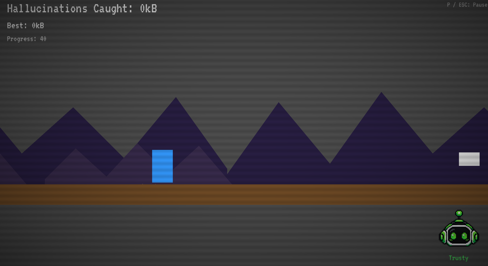

# With a Little Help from my Bot Friend

An endless runner built in **Godot 4.3** (GDScript) for the **CTW Game Jam 2026**,
themed **"AI gone wrong."**

You're trapped in a glitching AI system, jumping and crouching past deadly
obstacles while chasing camouflaged bonus "hallucinations" — all guided (and
occasionally misled) by your narrator bot, **Trusty**. Trusty means well, but
the more mistakes you make, the more his guidance glitches out: flashing
screens, jittery visuals, distorted music, and an ever-growing risk of a full
"System Corrupted" game over. Trustworthy AI vs. AI that hallucinates and
fails is the whole point — and it's on *you*, the player, to keep your eyes
on the obstacles rather than lean on him.

## Play it

- **Browser (itch.io):** https://martadev.itch.io/with-a-little-help-from-my-bot-friend
- **Windows:** the `.exe` isn't included in this repo (build artifacts are gitignored).
  Open the project in [Godot 4.3](https://godotengine.org/download/archive/#4.3) and
  export it yourself — see [Exporting projects](https://docs.godotengine.org/en/stable/tutorials/export/exporting_projects.html)
  in the official Godot docs, or the [Building / exporting](#building--exporting)
  section below.

## Controls

| Action | Keys |
| --- | --- |
| Jump | `Space` / `↑` |
| Crouch / fast-fall | `↓` / `Ctrl` |
| Pause | `P` / `Esc` |
| Restart | `R` / `Space` (on game-over screen) |

## How it works

- Auto-runner: the player character runs automatically, speeding up the
  longer you survive, with a diminishing-returns ramp so the game stays
  (humanly) playable indefinitely.
- Avoid deadly obstacles (spikes, lava, ceilings, bars) and holes — one hit
  ends the run.
- Catch camouflaged "hallucination" bonuses to grow your score, shown as
  memory units (kB → MB → GB) collected.
- Miss too many hallucinations and Trusty's guidance starts to degrade:
  screen flashes, a "funky"/glitchy visual effect, ambient shake, and
  distorted/broken background music — escalating toward a forced
  "System Corrupted" game over if you miss enough.
- An original 8-bit chiptune loop plays throughout, with its pitch and
  mix shifting across menus, run-start, normal gameplay, and the "broken"
  glitch state.

## Project layout

- `project.godot` — main scene `scenes/Intro.tscn`; autoload singletons
  `Game` (global run state/scoring/signals) and `Music` (background music
  + dynamic pitch/distortion).
- `scenes/` + `scripts/` — one `.gd` script per matching `.tscn` scene
  (`Intro`, `Main`, `Player`, `Narrator`, obstacles/bonuses, UI icons).
- `shaders/` — CRT intro look and glitch/funky-screen effect.
- `fonts/`, `themes/` — VT323 bitmap font (SIL Open Font License) + shared
  theme.
- `audio/` — original, royalty-free 8-bit chiptune background music.
- `sprites/`, `sketches/` — Trusty's avatar and UI reference art.

## Building / exporting

Requires the [Godot 4.3 Engine](https://godotengine.org/download/archive/#4.3).

- **Desktop (.exe):** `Project > Export > Windows Desktop > Export Project`.
- **Web (HTML5):** `Project > Export > Web > Export Project`, then serve the
  output folder (it can't be opened directly via `file://` — browsers block
  WASM loading that way). Upload the exported files as a `.zip` to a static
  host such as itch.io, or run `python -m http.server` locally to test.

## Credits

- Game, art, and code: [anamarta49](https://github.com/anamarta49)
- Font: [VT323](https://fonts.google.com/specimen/VT323) by Peter Hull
  (SIL Open Font License)
- Music: original composition, generated for this project
- Project code, music, and images were generated with the help of AI
  (GitHub Copilot CLI), directed and curated by [anamarta49](https://github.com/anamarta49)

Built for the **CTW Game Jam 2026** — theme: *"AI gone wrong."*
